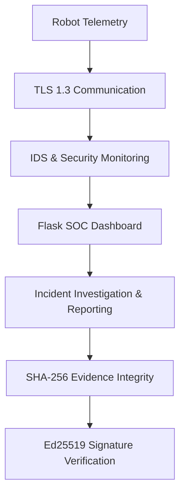
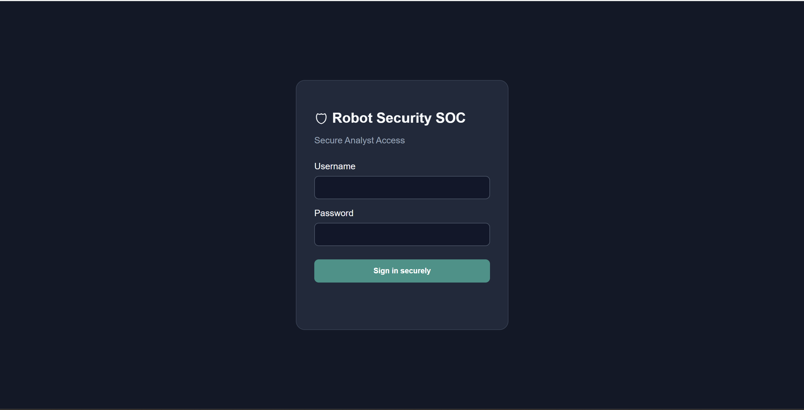
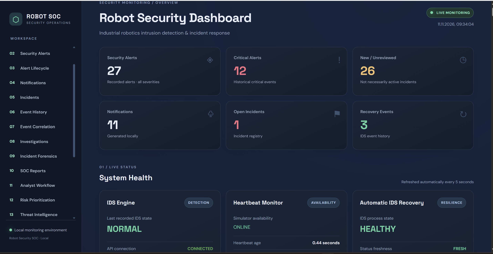
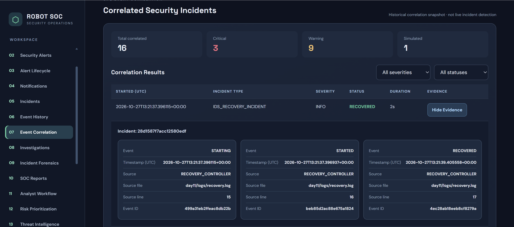

# Robot Security SOC

A hands-on Cybersecurity and Robotics Security portfolio project
focused on secure robot telemetry, intrusion detection, incident
investigation, digital evidence integrity, and SOC monitoring.

## System Architecture

High-level overview of the Robot Security SOC components.

This diagram shows the conceptual security architecture.

## Technology Stack

- Python 3
- Flask
- TLS 1.3
- SQLite
- Ed25519 digital signatures
- SHA-256 integrity verification
- HTML, CSS, JavaScript
- Ubuntu 24.04 / WSL2

## Project Overview

The project evolves through practical security engineering exercises,
starting with robot telemetry and network monitoring and progressing
toward incident investigation and cryptographic evidence verification.

Key implemented components include:

- Secure robot telemetry communication
- TLS-encrypted client/server communication
- Intrusion detection and alert monitoring
- Flask-based SOC dashboard
- IDS heartbeat monitoring
- Analyst authentication and authorization
- Incident investigation and reporting
- Evidence integrity verification
- Digitally signed incident report bundles

## Day 28 - Digital Signatures & Incident Integrity

Day 28 introduces Ed25519 detached digital signatures for incident
report manifests, combined with SHA-256 verification of exported
evidence files.

### Security Features

- Ed25519 signing and signature verification
- Encrypted private key storage
- Trusted public key fingerprint verification
- SHA-256 integrity verification
- Secure file access with symlink protection
- Authenticated Flask verification API
- SOC dashboard signature verification interface

### Verification Results

The following security scenarios were tested successfully:

| Security Test | Result |
| --- | --- |
| Tampered manifest detection | PASS |
| Tampered evidence detection | PASS |
| Forged signature rejection | PASS |
| Symbolic link rejection | PASS |

The final verification of the original incident bundle confirmed:

- Ed25519 signature: VALID
- SHA-256 integrity: VALID
- Verified evidence files: 3/3
- Overall status: SIGNED & VERIFIED

These results demonstrate the tested scenarios, not a complete
security audit or production certification.

## Project Structure

- `day06/` - Flask SOC dashboard
- `day18/` - Analyst authentication
- `day25/` - Incident case management
- `day26/` - Incident reporting
- `day27/` - Report integrity verification
- `day28/` - Digital signatures and secure verification

## Local Setup

The project includes a setup script for initializing SOC analyst authentication.

### 1. Clone the repository

    git clone https://github.com/S3rgiu12/robot-security-soc.git
    cd robot-security-soc

### 2. Create a Python virtual environment

    python3 -m venv .venv
    source .venv/bin/activate

### 3. Install dependencies

    python -m pip install -r day06/requirements.txt
    python -m pip install cryptography==50.0.2

### 4. Initialize SOC authentication

    python setup_soc.py

The setup script:
- Generates a local Flask secret if one does not exist.
- Initializes the SQLite analyst authentication database.
- Prompts for an administrator username and password.
- Stores passwords using scrypt hashes.

Passwords must contain at least 12 characters.

### 5. Start the SOC dashboard

    python day06/app.py

The dashboard is configured to listen at:

    http://127.0.0.1:5000

Note: Some SOC dashboard features depend on runtime data generated
by earlier project exercises. Additional local configuration may be
required for those integrations.

Security note: Authentication databases, local secrets, private keys,
and generated evidence must never be committed to GitHub.

## Running Security Tests

Requirements:
- Python 3.12
- pip
- Linux environment (Ubuntu recommended)

Clone the repository and enter the project directory.

Install the cryptographic dependency:

    python3 -m pip install cryptography==50.0.2

Run the Day 28 security test suite:

    python3 -m unittest discover -s day28/tests -p "test_*.py" -v

The test suite covers:
- Ed25519 signature verification
- SHA-256 evidence integrity
- Modified evidence detection
- Forged signature rejection
- Untrusted public key rejection
- Symbolic link protection

The tests use temporary cryptographic fixtures and do not require
private signing keys or exported production incident data.

GitHub Actions automatically executes these tests on pushes and
pull requests targeting the main branch.

## Security and Privacy

Private keys, environment files, operational databases,
generated evidence exports, and runtime artifacts are excluded
from version control.

Never commit real credentials or private signing keys.

The project is intended for educational and portfolio purposes.
Deployment requires additional configuration, security review,
and environment-specific hardening.

## Author

Sergiu Dumitrasc

Cybersecurity | Robotics Security | Software Development

## Application Screenshots

### SOC Analyst Authentication

The Robot Security SOC includes a dedicated analyst login interface
with session-based authentication and role-based access control.

### SOC Monitoring Dashboard

The SOC dashboard provides a centralized interface for monitoring
robot security events, IDS alerts, system availability, and incidents.

### Security Incident Correlation

The SOC provides historical incident correlation, severity
classification, event timelines, recovery status, and
traceability to supporting log evidence.

